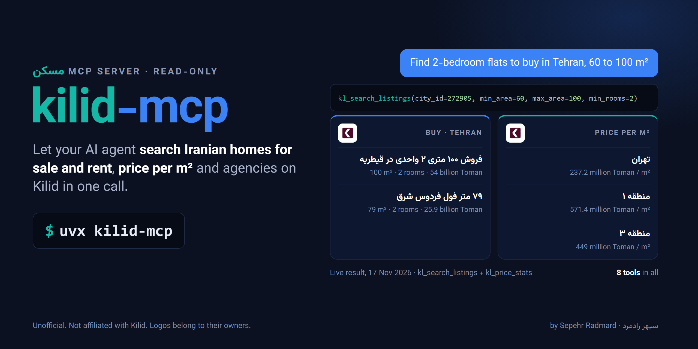

<!-- mcp-name: io.github.sepehr071/kilid-mcp -->

<div align="center">



# kilid-mcp: Kilid (کیلید) real-estate MCP server for AI agents, homes for sale and rent in Iran

**kilid-mcp is an unofficial, read-only MCP server that lets an AI agent search homes for sale and rent, read house prices per square metre and look up agencies on Kilid (کیلید, kilid.com), a large Iranian real-estate portal.**<br>
Its 8 tools search buy and rent listings with price, area, room and district filters, open one listing in full, read the median price per m² by city, district and neighborhood with a 12-month trend, rank neighborhoods by price, and find agencies.<br>
No API key or account is needed; it works in Claude, Cursor, Copilot and any other MCP client.

[](https://pypi.org/project/kilid-mcp/)
[](https://pypi.org/project/kilid-mcp/)
[](https://github.com/sepehr071/kilid-mcp/actions/workflows/ci.yml)
[](https://github.com/sepehr071/kilid-mcp/blob/main/LICENSE)

[For AI agents](#for-ai-agents) · [Quick start](#quick-start) · [Tools](#tools) · [Limits](#limits) · [فارسی](#فارسی)

</div>

---

## For AI agents

- **What:** unofficial MCP server (model context protocol) for kilid.com: cities and districts, listing search (sale and rental), listing detail, house-price statistics with a 12-month trend, neighborhood price ranking, agencies.
- **Install:** `uvx kilid-mcp` or `claude mcp add kilid -- uvx kilid-mcp`. Transport: stdio. Needs [uv](https://docs.astral.sh/uv/getting-started/installation/) (Python 3.10+).
- **Auth:** none. Optional `KILID_MCP_PROXY` (HTTP proxy URL, or a comma-separated list); system proxy settings are ignored.
- **Access:** read-only. It cannot log in, save listings, contact agencies or reveal phone numbers, so no confirmation is needed before calling any tool.
- **Tools:** 8, all prefixed `kl_`. Typical sequence: `kl_cities` -> `kl_districts` -> `kl_search_listings` -> `kl_listing`; `kl_price_stats` and `kl_neighborhood_prices` for market levels; `kl_agencies` -> `kl_agency`.
- **Use when:** the user wants apartments or houses for sale or rent in an Iranian city, what a square metre costs in a district, or the priciest neighborhoods.
- **Do not use when:** the user needs advertiser phone numbers, sold-price records, or to publish an ad.
- **Output:** compact JSON. Prices are Toman. Rentals return the deposit as `price_toman` and the monthly rent as `rent_toman`. Text is Persian.

## Quick start

You need [uv](https://docs.astral.sh/uv/getting-started/installation/). No API key or account.

Claude Code:

```bash
claude mcp add kilid -- uvx kilid-mcp
```

Claude Desktop, Cursor, VS Code and other clients:

```json
{
  "mcpServers": {
    "kilid": { "command": "uvx", "args": ["kilid-mcp"] }
  }
}
```

Example prompts:

- "Find 2-bedroom flats to buy in Tehran between 60 and 100 m²."
- "What is the median price per square metre in Tehran and in its first district?"
- "Which Karaj neighborhoods are the most expensive?"
- <span dir="rtl">آپارتمان اجاره‌ای دو خوابه در شیراز پیدا کن.</span>
- <span dir="rtl">قیمت هر متر خانه در ولنجک چقدر است؟</span>

Real answer (17 Nov 2026): `kl_price_stats(area="tehran")` returned a median of 237,179,487 Toman per m² (period 1405-08, sample 433,751 listings), and `منطقه 1` at 571,428,571 Toman per m².

## Tools

| Tool | What it does |
|---|---|
| `kl_cities` | Find a city id and slug by Persian name, with whether district data exists. |
| `kl_districts` | List municipal districts or neighborhoods of a city with their ids and slugs. |
| `kl_search_listings` | Search buy or rent listings by city, districts, property type, price, rent, area, rooms, sort and page. |
| `kl_listing` | Read one listing: price, area, rooms, floor, facilities, description, map point and agency. |
| `kl_price_stats` | Median price per m² for a city or area, its sub-areas and the 12-month trend. |
| `kl_neighborhood_prices` | Rank a city's neighborhoods by median price per m², with a data-quality flag. |
| `kl_agencies` | Search agencies registered on Kilid by name. |
| `kl_agency` | Read one agency: address, district, location, active listings and agent count. |

## Limits

- Prices are asking prices from listings, not sale records. `year_change_pct` is the site's own `yoyPct` field; the page itself shows a client-side figure that differs a little.
- Featured (paid) listings can appear on top even when they fall outside the filters. `rent_toman` 0 means deposit only.
- Advertiser phone numbers sit behind a reveal button on the site and are deliberately not returned.
- Kilid is a Next.js site and several tools read data embedded in its server-rendered pages. If Kilid renames those props, a tool can come back empty until the server is updated.
- Heavy use and rate limits were not probed. Requests run two at a time with a short cache. It answers from abroad and from Iran.

## How it works

Kilid has no public API. The server calls the JSON routes the site's own pages use (`/api/search`, `/api/listings`, `/api/regions`, `/api/provinces`, `/api/neighborhoods/finder`, `/api/agency/suggest`) and reads the data embedded in its server-rendered pages (listing page one, listing detail, price reports, agencies). The routes were mapped in a real browser and every tool's output was checked in Chrome against the rendered kilid.com pages. Requests present Chrome's TLS fingerprint.

## فارسی

<div dir="rtl">

kilid-mcp یک سرور MCP غیررسمی و فقط‌خواندنی است که به دستیار هوش مصنوعی اجازه می‌دهد آگهی‌های خرید و اجاره‌ی ملک، قیمت هر متر مربع خانه و بنگاه‌های املاک را در کیلید (kilid.com) جست‌وجو کند. هشت ابزار دارد: جست‌وجوی آگهی با فیلتر قیمت، متراژ، تعداد اتاق و محله، دیدن کامل یک آگهی، قیمت میانگین هر متر به‌تفکیک شهر و منطقه و محله، رتبه‌بندی محله‌ها و پیدا کردن بنگاه. کلید API یا حساب کاربری لازم نیست. نصب در Claude Code:

</div>

```bash
claude mcp add kilid -- uvx kilid-mcp
```

## Development

```bash
uv sync
uv run ruff check . && uv run ruff format --check .
uv run python -m pytest -q          # offline, saved fixtures
uv run python -m pytest -m live -q  # real kilid.com
```

Releases: bump the version in `pyproject.toml` and `server.json`, run `uv lock`, then push a `v*` tag; GitHub Actions publishes to PyPI and the MCP Registry.

## Disclaimer

Unofficial and not affiliated with or endorsed by Kilid. It is read-only and uses the public pages and routes of kilid.com, which can change without notice.

## Author

Built and maintained by **Sepehr Radmard** (سپهر رادمرد). [LinkedIn](https://www.linkedin.com/in/sepehr-radmard) · [GitHub](https://github.com/sepehr071) · more servers in [iran-mcp](https://github.com/sepehr071/iran-mcp).

## مجوز استفاده (License)

<a href="https://www.linkedin.com/in/sepehr-radmard"></a>

**استفادهٔ شخصی و غیرتجاری رایگان است.** استفاده در شرکت، محصول پولی یا پروژهٔ مشتری به مجوز تجاری نیاز دارد؛ از راه [لینکدین](https://www.linkedin.com/in/sepehr-radmard) یا [گیت&zwnj;هاب](https://github.com/sepehr071) با سپهر رادمرد تماس بگیرید. متن کامل: [PolyForm Noncommercial 1.0.0](https://github.com/sepehr071/kilid-mcp/blob/main/LICENSE). نسخه&zwnj;های پیش از 0.1.1 با مجوز MIT منتشر شده&zwnj;اند و همان مجوز را دارند.

Free for personal and non-commercial use under the [PolyForm Noncommercial License 1.0.0](https://github.com/sepehr071/kilid-mcp/blob/main/LICENSE). Using it in a company, a paid product or a client project needs a commercial license: contact Sepehr Radmard on [LinkedIn](https://www.linkedin.com/in/sepehr-radmard) or [GitHub](https://github.com/sepehr071). Versions before 0.1.1 were released under MIT and stay under it.
